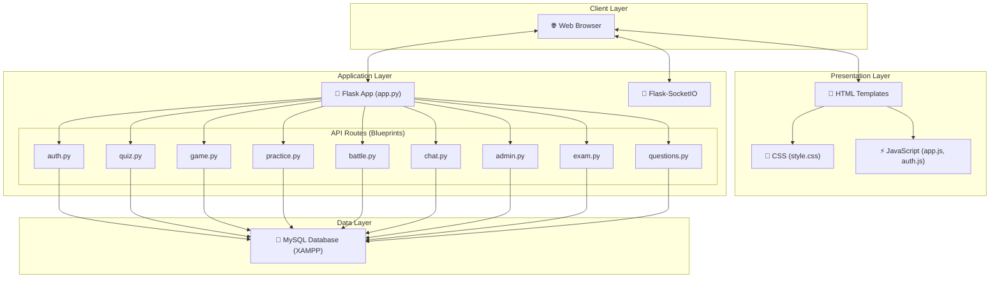
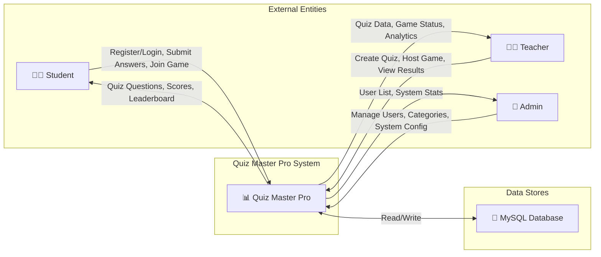
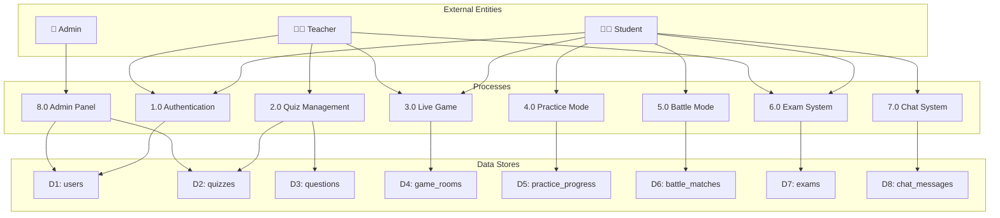
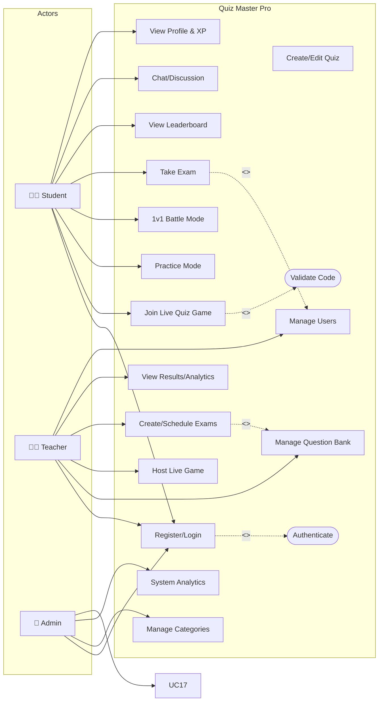
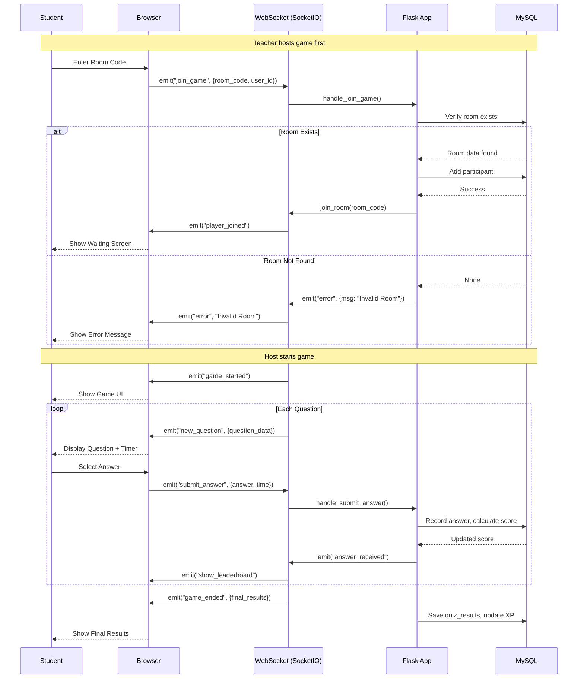

# Quiz Master Pro - System Diagrams

## 1. High-Level Architecture

---

## 2. Data Flow Diagram (DFD) - Level 0

---

## 3. Data Flow Diagram (DFD) - Level 1

---

## 4. Use Case Diagram

---

## 5. Sequence Diagram - Live Quiz Game Flow

---

## 6. Database ER Diagram

```mermaid
erDiagram
    USERS ||--o{ QUIZZES : creates
    USERS ||--o{ GAME_ROOMS : hosts
    USERS ||--o{ GAME_PARTICIPANTS : joins
    USERS ||--o{ PRACTICE_PROGRESS : has
    USERS ||--o{ BATTLE_MATCHES : plays
    USERS ||--o{ QUIZ_RESULTS : earns
    USERS ||--o{ EXAM_SUBMISSIONS : submits
    USERS ||--o{ CHAT_MESSAGES : sends

    CATEGORIES ||--o{ QUIZZES : contains
    CATEGORIES ||--o{ PRACTICE_PROGRESS : tracks

    QUIZZES ||--o{ QUESTIONS : has
    QUIZZES ||--o{ GAME_ROOMS : used_in
    QUIZZES ||--o{ EXAMS : based_on

    GAME_ROOMS ||--o{ GAME_PARTICIPANTS : has

    EXAMS ||--o{ EXAM_SUBMISSIONS : receives

    CHAT_ROOMS ||--o{ CHAT_MESSAGES : contains

    USERS {
        int id PK
        string username
        string email
        string password_hash
        enum role
        int xp_points
        int level
    }

    QUIZZES {
        int id PK
        string title
        int category_id FK
        int created_by FK
        enum difficulty
    }

    QUESTIONS {
        int id PK
        int quiz_id FK
        enum type
        text question_text
        json options
        string correct_answer
    }

    GAME_ROOMS {
        int id PK
        string room_code
        int quiz_id FK
        int host_id FK
        enum status
    }

    EXAMS {
        int id PK
        string title
        int quiz_id FK
        datetime start_time
        datetime end_time
    }
```

---

## Technology Stack Summary

| Layer | Technology |
|-------|------------|
| Frontend | HTML5, CSS3, JavaScript |
| Backend | Python Flask |
| Real-time | Flask-SocketIO (WebSockets) |
| Database | MySQL (via XAMPP) |
| Authentication | Session-based with password hashing |
| Styling | Custom CSS with Glassmorphism design |
